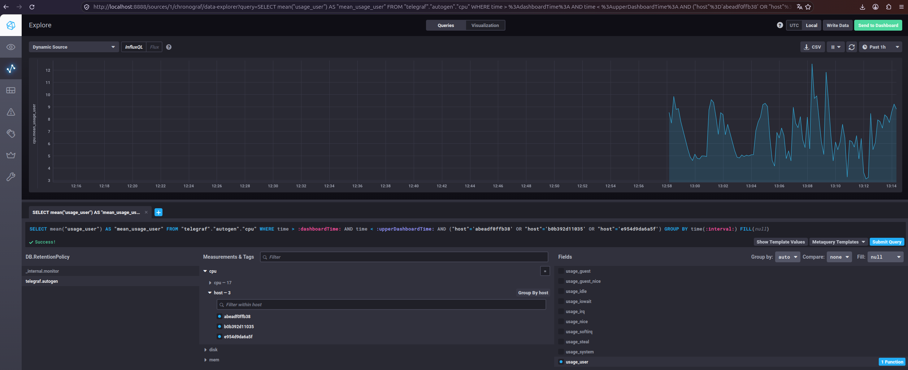

# Домашнее задание 13. Системы мониторинга

## Теоретические вопросы

### Минимальный набор метрик
Для платформы, где HTTP-взаимодействие, вычисления нагружают CPU, а отчёты сохраняются на диск, минимальный набор:

    CPU usage (по ядрам и по подам/контейнерам) — потому что вычисления именно нагружают CPU; важно видеть пики и среднюю утилизацию, чтобы понимать, хватает ли ресурсов и где «узкое горлышко».
    Memory (RAM) usage и RSS/working set — чтобы не было OOM-киллов и деградации из‑за свопа.
    Disk I/O latency (read/write) и throughput — отчёты сохраняются на диск; если диск медленный или забитый, это будет узким местом.
    Disk space и inodes — чтобы вовремя заметить, что место или иноды заканчиваются (особенно при большом количестве мелких файлов).
    HTTP request rate, latency (p50/p95/p99), и распределение кодов ответов (2xx, 4xx, 5xx) — это основной интерфейс для клиентов; по ним оценивают доступность и качество сервиса.
    Queue length / backlog of pending computations — если есть очередь задач на вычисления, её размер и время в очереди напрямую влияют на SLA.
    Errors per second и error rate (errors/requests) — чтобы видеть ухудшение качества и быстро реагировать.

Почему этого достаточно: набор покрывает «золотые сигналы» (latency, traffic, errors, saturation) и специфику задачи (CPU-bound, запись отчётов).

### Перевод метрик для менеджера
Переводи метрики на язык бизнеса и SLA:

    SLA по доступности (uptime / доля успешных запросов) — например, «99.9% успешных HTTP-запросов за 5 минут».
    SLO по времени ответа — «p95 latency ≤ 2 сек для 95% запросов».
    Доля ошибок — «error rate ≤ 0.1%».
    Время выполнения задачи (job duration) — «95% задач завершаются за ≤ N минут».
    Процент задач, завершившихся с ошибкой — «≤ 0.5% задач не смогли сгенерировать отчёт».

Что показать менеджеру: дашборды с крупными цифрами (uptime %, p95 latency, error rate) и графиками тренда. Метрики вроде RAM/inodes оставь техническим дашбордам, а менеджеру — только бизнес‑метрики и их связь с SLA.

### Решение без системы сбора логов
Варианты без отдельного «тяжёлого» ELK/Loki стека:

    Централизованный stdout + агрегация на уровне оркестратора (Kubernetes/Nomad/ECS) — все приложения пишут в stdout/stderr, а платформа собирает логи и даёт просмотр по сервисам/подам.
    Tail/grep по логам на хостах через SSH/Ansible — быстрый способ для небольшого числа серверов.
    Простой сборщик логов (Fluent Bit/Filebeat) + хранение в объектном хранилище (S3/MinIO) — дёшево, можно хранить только логи уровня error/warn.
    Алерты по ошибкам через мониторинг — в Prometheus/Telegraf можно настроить алерт на рост ошибок в логах (если есть парсинг) или на коды ошибок приложения.
    Логирование в структурированном формате (JSON) — чтобы разработчики могли быстро фильтровать по полям (service, level, error_code) даже в простом grep.

Для учебного задания хватит: «приложения пишут структурированные логи в stdout, логи собираются платформой (Docker/K8s), разработчики смотрят через docker logs / веб‑интерфейс оркестратора и получают алерты при росте ошибок».
### Ошибка в расчёте SLA
Ошибка в том, что не все запросы попадают в числитель и знаменатель одинаково, либо не учитываются другие коды, либо агрегация неверная.

Возможные причины:

    В знаменателе есть запросы, которые не считаются 2xx (например, 3xx, 1xx, или даже 0xx/ошибки сети без HTTP‑кода).
    Некорректная агрегация по времени: числитель и знаменатель берутся из разных временных окон или с разной гранулярностью.
    Фильтрация: часть запросов исключается из числителя, но остаётся в знаменателе (или наоборот).
    Сетевые ошибки/таймауты не дают HTTP‑кодов и не попадают в 2xx, но могут учитываться как «запросы» в знаменателе.
    Разные источники метрик: числитель из одного экспортера, знаменатель из другого, с разной выборкой.

Как исправить: убедиться, что в числителе и знаменателе одинаковые типы запросов и одинаковые окна агрегации, и что учитываются все коды (включая 3xx и прочие), либо явно определить SLA только по 2xx.

### Плюсы/минусы pull и push
Pull (например, Prometheus)

Плюсы:

    Простота конфигурации: экспортеры только отдают метрики, Prometheus сам их собирает.
    Встроенные агрегации и язык запросов (PromQL).
    Хорошо работает в Kubernetes (ServiceMonitor/PodMonitor).

Минусы:

    Не подходит для очень больших масштабов без федерации/долгосрочного хранения.
    Сложно собирать метрики с «недоступных» или NAT‑хостов.
    Частые скрапы могут создавать нагрузку на экспортеры.

Push (например, InfluxDB + Telegraf, Zabbix Active)

Плюсы:

    Подходит для хостов за NAT/файрволами.
    Можно отправлять данные пакетно, снижая нагрузку на сеть.
    Удобно для временных/коротких задач (батчевые джобы).

Минусы:

    Нужно управлять агентами и их конфигурацией.
    Меньше встроенных возможностей агрегации на стороне сервера.
    Риск «переполнения» сервера при всплесках.

### Push/Pull/Гибрид
    Prometheus — pull.
    TICK (Telegraf + InfluxDB) — push (Telegraf отправляет в InfluxDB).
    Zabbix — гибридная: пассивные проверки (pull) и активные (push от агента).
    VictoriaMetrics — push/pull в зависимости от клиента: может принимать через remote_write (push) и имеет scrape‑интерфейс (pull).
    Nagios — pull (сервер опрашивает хосты/сервисы).

## Практическая часть
### Состав стека

- **Telegraf** — сборщик метрик. В текущей конфигурации собирает метрики хоста: CPU, память, диск (плагин `inputs.docker` отключён из‑за ограничений AppArmor).
- **InfluxDB 1.8** — база данных временных рядов, хранит собранные метрики.
- **Chronograf** — интерфейс для визуализации метрик и построения запросов. Используется для отображения графиков и проверки работы стека.
- **Kapacitor** — сервис для обработки данных и настройки алертов. Запущен и подключён к InfluxDB; в рамках лабораторной работы настроен, но алерты не создаются.

